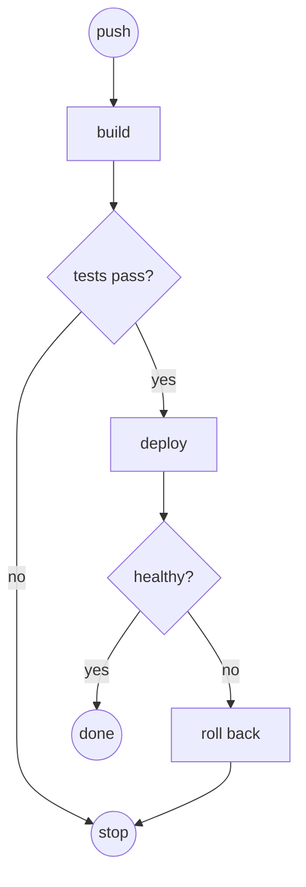

Explain the current topic with a picture beside a few lines of prose. Pick the smallest view that makes the key point clear; one view, two at most. Keep only the nodes, calls, files, props and states the question needs.

## Flowchart, for anything that branches, loops or runs in stages

Write a ` ```mermaid ` fence with `graph TD` (or `LR` for a short pipeline). cs-mermaid draws it in place: a decision in `{ }` amber, a start or end in `(( ))` green or grey, a step in `[ ]` lavender, and a `yes`/`no` label green or red. The drawing covers only this subset: no subgraphs, no self-loops, no other diagram types, short labels. A fence outside it stays source with the reason under it.



Skip the chart for a task list or numbered steps; those read better as a list.

## Text sketches, for structure without a flow

- Logic or an algorithm as pseudocode:

```text
on(save)
  if content is unchanged
    return cached result
  write new content
  return fresh result
```

- Runtime control flow as a call tree:

```text
submitForm
  createSession
    persistPrompt
    launchAgent
  navigateToSession
```

- UI structure as a component tree, with the state hooks and module boundaries that matter:

```tsx
<SessionPage> (apps/example/src/routes/session.tsx)
  useSessionEvents()
  <SessionToolbar>
    <RunSkillButton> (packages/ui)
```

- File responsibility or a broad refactor as a shallow file tree:

```text
src/
├── commands/       # parses user actions
├── sessions/       # owns session state
└── transport/      # sends API requests
```

## Diff, when the point is what changes

Use a `diff` fence over whichever sketch above fits the topic, so the surrounding shape stays and the change stands out:

```diff
 submitForm
   createSession
     persistPrompt
+    expandSkillMention
     launchAgent
-  navigateToSession
+  navigateToSession
+    subscribeToEvents
```

Show a whole block instead when most of it is new, or when the user needs a copyable target shape.

Place each picture next to the sentence it supports, and stop once the picture has made the point.
